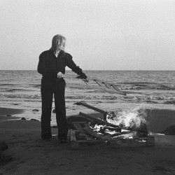
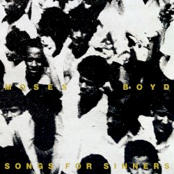
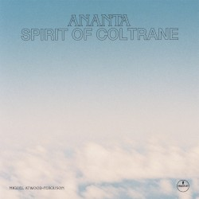

A little late on this one, but October 30th was stacked: seven favorites and a handful more worth your time.

---

## THAO - Show Me

_Tasting Notes: A kitchen dance party the week the divorce papers clear._

THAO's first album in six years, made with Merrill Garbus and Nate Brenner of tune-yards. She wrote it through a divorce and calls it a real-time record of her life moving into a new relationship with love and desire, and the first time she's written about sex and queer identity. The Linda Lindas show up on "Sick Of The Times," which is a sentence I'm very happy to type.

---

## Jordan Rakei - A Safe Place To Be Wild

_Tasting Notes: A candlelit Sunday at Abbey Road with the good headphones on._

Album number seven. Most of these 14 songs came together while Rakei was Abbey Road's first-ever Artist in Residence, and he calls it his most instinctive, fearless record yet: self-acceptance, vulnerability, and letting go of everyone's expectations. Start with "Enemies."

---

## Sampa the Great - Nu Zamrock

_Tasting Notes: Finding your uncle's band on a dusty '70s LP, then starting a new one._

Sampa found out her uncle, George Kunda (aka Groovy Joe), was a founding member of WITCH, the Zambian psych-rock band at the heart of the 1970s Zamrock scene. Her third album takes that family legacy back, with Cadenze executive producing. In her words: "Nu Zamrock is not nostalgia."

---

## Sam Burton - Fairweather Friend

_Tasting Notes: Golden-hour folk rock from a van with a fresh dent in it._

Burton's third solo album and his first for Captured Tracks, produced by Jonathan Wilson. It took shape after a car accident on tour broke the project apart, and he kept writing up in Northern California. He says lead single "I'm A Stranger" sits somewhere between nostalgia and alienation.

---

## Kali Malone - Burning Song

_Tasting Notes: Dozing off in a cathedral and not minding one bit._

Seven pieces for Bach organ, cello and bowed acoustic guitar, recorded over two late nights at the Thomaskirche in Leipzig, with Lucy Railton on cello and Stephen O'Malley on guitar. It's her first solo-composition album since 2024's _All Life Long_, and it loosens the strict canon forms of her earlier organ work into something more intuitive. Start with "Heavy With Fruit."

---

## Moses Boyd - Songs for Sinners

_Tasting Notes: Sunday service that spills straight into a Saturday-night sound system._

The London drummer's first solo album in six years, following the Mercury-nominated _Dark Matter_, out on his own Exodus label. He says it's the hardest he's ever worked on music, pulling from gospel, jazz and sound system culture. "Criticise," with Amber-Simone, is about shame and forgiveness.

---

## Miguel Atwood-Ferguson - ANANTA: Spirit of Coltrane

_Tasting Notes: A 21-piece band throwing John Coltrane a 100th birthday party in orbit._

For Coltrane's 100th birthday, Atwood-Ferguson leads a 21-piece collective (Brandee Younger, Jeff Parker, Immanuel Wilkins, Shabaka Hutchings, Joel Ross and more) through seven Coltrane pieces, including a section of "A Love Supreme," plus an original with words by poet Aja Monet. First single "Compassion" brings in Flying Lotus.

---

## Also out

- Aaron Frazer - Corners: a six-song EP made with no pressure and no tour deadline
- DIIV - ZIRP!: their fifth, produced by A. G. Cook, lighter and poppier
- EX:RE - Save As: Elena Tonra of Daughter, back with her first Ex:Re album in eight years
- 2nd Grade - Girls and Boys: 20 power-pop songs, ten about kinds of girls and ten about kinds of boys
- MorMor - No One Alive Will Listen: a break-up record co-produced with Hudson Mohawke and Jack Penate
- OR (John Talabot) - Music for Empty Stadiums: a beatless "anti-ambient" diary from the lockdown years
