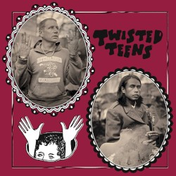
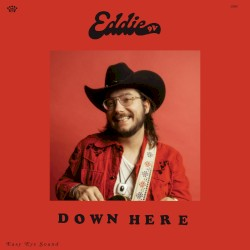

November 6th leaned guitar-and-heart: five favorites, plus a few more I kept coming back to.

---

## Chastity Belt - All My Friends

_Tasting Notes: A group text that turned into a reunion tour._

Album number six, out on Suicide Squeeze. The band lives in three different cities now, so it came together over sessions all over the map, mixing brand-new songs with ones that go back to 2018 and a few from a band trip to the Greek island of Hydra. Like most of their records, it takes a couple of spins to open up. Start with "Hold My Own."

---

## Katie Gregson-MacLeod - Albatross

_Tasting Notes: The long drive back up north, with the heater barely working._

The Inverness songwriter's debut album, out on Matt Maltese's Last Recordings on Earth after she walked away from her major-label deal. Twelve songs about desire, a relationship ending and coming home to Scotland, framed around Coleridge's Ancient Mariner. Dom Monks produced it with Will Taylor of Flyte, and they cut it live in Frome over two weeks. Start with "Nothing Really Changes."

---

## Hudson Freeman - Doom Country

_Tasting Notes: A road trip through the end times with a busted tape deck._

Hudson Freeman's Mom+Pop album plays like the soundtrack to a post-apocalyptic road trip, with him working back through the Rapture and his religious upbringing. It's scrappy, folk-tinged indie rock with some sludge in it, partly recorded at Figure 8 in Brooklyn. Sophie Brown harmonizes on "Fell Ass Backwards," and "Left Behind" is a great first listen.

---

## Twisted Teens - The Holy Cross Tigers

_Tasting Notes: Heartbreak, but you're dancing about it in a church basement._

Their third album of 2026 (after _Blame the Clown_ and _Florida Water Blues_) and their first for Sub Pop. The duo calls it "their very own Blood On The Tracks," and it's 13 songs of twangy folk, blues and punk that stay lively even when they're sad. Start with "Look In The Mirror."

---

## Eddie 9V - Down Here

_Tasting Notes: Sweet tea on the porch with the amp turned up._

The Atlanta singer's first record for Easy Eye Sound, produced by Dan Auerbach in Nashville, with co-writers including Marcus King. It's Southern soul, blues and rock and roll, with a cover of "Rock Your Baby." The title track is about time spent with his grandparents in Georgia.

---

## Also out

- Willi Carlisle - The Universal Bubba: a 17-song double album produced by Tyler Childers, cut in two weeks in New Orleans
- Dawuna - Love's Arp: love songs made at home in Baltimore, mixing East African rhythms, old gospel and house
- Catherine Elicson - River Of Fat: a lo-fi solo debut from the leader of Philadelphia's Empath
- Natalie Bergman - I Killed A North American Songbird: a five-song Third Man EP that turns from grief to the natural world
- BINA. - Soft Rage: a trip-hop-leaning mixtape, with Tkay Maidza on "R U OK?"
