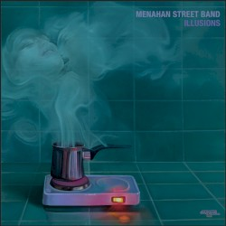
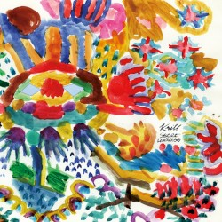
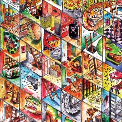
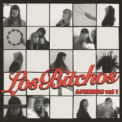
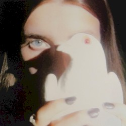

November 13th had a little of everything: six favorites, from instrumental soul to the densest rap record of the month, plus a few more worth a spin.

---

## Menahan Street Band - Illusions

_Tasting Notes: The opening credits of a '70s heist movie you'd actually watch._

The instrumental crew's fourth album and their first in about five years, out on Tom Brenneck's Diamond West Records. Brenneck says they wrote and recorded it fast, with no time for second-guessing. Brazilian arranger Arthur Verocai wrote the strings for lead single "Palace of Illusions," which is where to start.

---

## Krill - Secret Language

_Tasting Notes: Bedtime stories for your kid, read over a fuzz pedal._

Krill's first album since 2015's _A Distant Fist Unclenching_, nine songs on Exploding in Sound and Stereogum's Album of the Week. Jonah Furman and Ian Becker are joined by Andrew Clinkman (Moontype, Spirits Having Fun), with Will Greene on sax. Furman says "Dominate" is about growing up in the '90s and '00s "in the heart of empire," and the title track is about putting his son to bed.

---

## Snoh Aalegra - Legendary Love

_Tasting Notes: Slow-dancing in the kitchen to a tape someone made you in 1994._

Her fourth album and first since 2021, about what she calls a karmic connection that never quite came together. It took two and a half years and leans into '80s and '90s R&B, with synths, funk and big basslines, and a list of collaborators that includes Babyface, Jimmy Jam & Terry Lewis, Nile Rodgers, Raphael Saadiq and Daniel Caesar. Start with the title track.

---

## Armand Hammer - Snakes & Ladders

_Tasting Notes: A puzzle box you keep turning over long after the lights go out._

billy woods and ELUCID dropped this with no warning two days early. Sixteen tracks, no guest rappers, and a different producer on nearly every song, including clipping., Kenny Segal, Child Actor, Petter Eldh, Saint Abdullah and Preservation. NPR calls it a career peak. Start with "Assembly Lines."

---

## Los Bitchos - Los Bitchos & Friends Vol. 1

_Tasting Notes: A rooftop party where every guest brought a different instrument._

The London band's third album opens their instrumental cumbia-psych up to guests, using voices as one more texture instead of straight-ahead lyrics. The friends include Ambrose Kenny-Smith, Sinkane, Adrian Quesada, Chicha Libre and Kit Sebastian. Start with "Walk in Salem."

---

## Emma Ogier - Fly 1111

_Tasting Notes: Leaving Houston for Nashville with everything you own in the back seat._

The Houston-born, Nashville-based songwriter's debut album, out on Lost Highway and produced by David Baron (The Lumineers, Noah Kahan). Twelve songs that pair a little twang with scrappy indie rock, about what a creative life costs and learning to trust yourself. Start with the title track.

---

## Also out

- Land of Talk - Lasts: eight songs Elizabeth Powell recorded at a cabin in Harrington, Quebec
- Aesop Rock & Blockhead - Trouble Mountain: a 17-track "(fake) Ski Lodge" inspired by old Poconos getaway commercials
- Anna Butterss, John Raymond & Ben Lumsdaine - Beginningless: a fully improvised trio record, cut live in two days in LA
- Fog Lake - Hollowbody: lo-fi bedroom folk made in about three weeks, co-produced by Foxes In Fiction
- U2 - Carnaval de Luz: their first all-new studio album in nine years, produced by Jacknife Lee with Brian Eno
