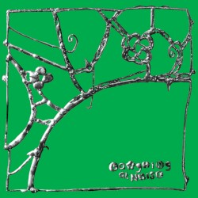
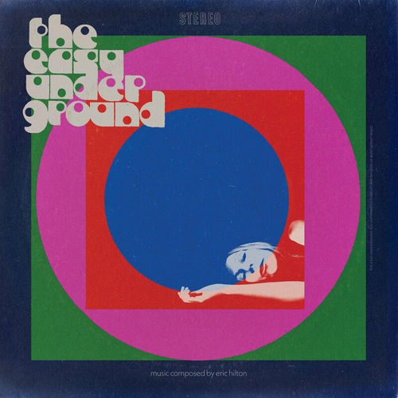
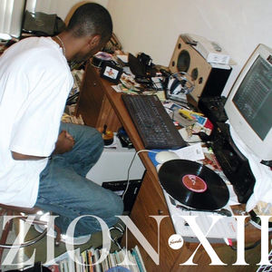

November 20th was a deep week. Three favorites rose to the top, and there's a long list of other good ones underneath.

---

## Bodywash - Laughing at Noise

_Tasting Notes: Getting older in a city that keeps tearing down your favorite bars._

The Montreal duo's third album, out on Light Organ, is about getting older in a city that keeps changing. It's looser and noisier than their earlier dream pop, with acoustic songwriting in place of keys and a scrappy '90s indie-rock edge. They name Elliott Smith and Kim Gordon as touchstones, and they self-produced it over a year. Start with "Eye to Eye."

---

## Eric Hilton - The Easy Underground

_Tasting Notes: Cocktail hour at a Rio hotel bar that time forgot._

A solo record from Thievery Corporation's Eric Hilton, made as a tribute to the easy-listening and soundtrack music of the '60s and '70s: bossa nova, Brazilian rhythms and lots of groove. Longtime collaborator Natalia Clavier sings on nine of the 13 tracks, in several languages. Start with "Alma Boa."

---

## 9th Wonder - Zion XII

_Tasting Notes: Crate-digging in a dorm room with the door propped open._

The twelfth entry in 9th Wonder's yearly Zion series, which started in 2016 as a home for his unused beats. It showed up with almost no announcement, so expect a beat tape in the J Dilla tradition rather than a rapper's album. Start with "Can't Breathe," featuring Smitty.

---

## Also out

- Lael Neale - As Killers Do: her first self-released album, recorded on a cassette 8-track in her Echo Park kitchen
- Toro y Moi - Unusua: a quiet, mostly instrumental piano record from Chaz Bear
- Gabriels - Blood On My Hands: a four-song EP, their first music since Jacob Lusk left, with Say She She guesting
- Joshua Redman - If Ever You Would Leave Us (We Play for Rollins): a Blue Note tribute to Sonny Rollins with Christian McBride and Chris Potter
- Lambchop - Demoed: Kurt Wagner's demos sung by guests like MJ Lenderman, Alan Sparhawk and Circuit des Yeux
- Julianna Barwick & Mary Lattimore - Threshold: their score for the documentary about Olympic skier Jessie Diggins
- Sheherazaad - Khudgarzi: an Erased Tapes debut sung mostly in Urdu, with 30-plus musicians
- The Cindys - Love Century: a jangly debut with Naima Bock in the band, recorded straight to tape at Rockfield
