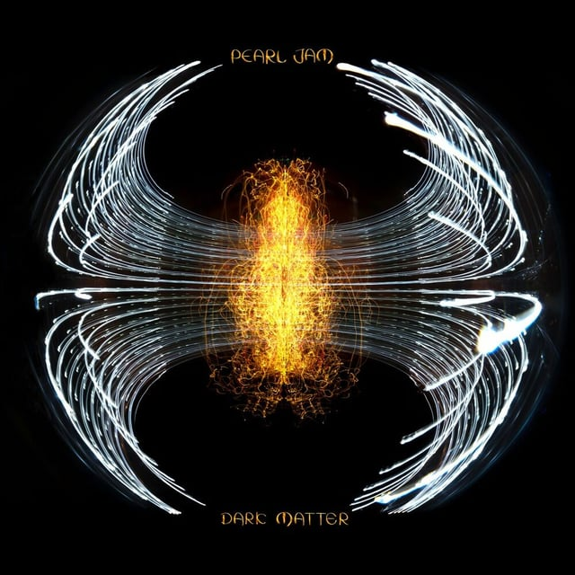
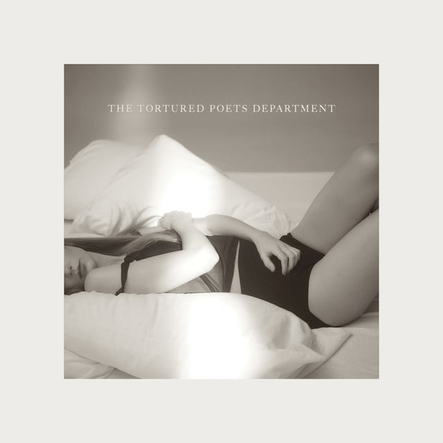

## <iframe style="border-radius:12px" src="https://open.spotify.com/embed/playlist/4fafpTRxqK1BOrJcLryuNO?utm_source=generator&theme=0" width="100%" height="352" frameBorder="0" allowfullscreen="" allow="autoplay; clipboard-write; encrypted-media; fullscreen; picture-in-picture" loading="lazy"></iframe>

---

## Lucy Rose - This Ain’t The Way You Go Out

The English singer/songwriter has been making amazing music for over a decade, and I couldn’t be more excited for her to release a new album! Introducing a slew of new instruments and sounds to her typically acoustic setup fills this album with surprising joyous moments. I’m glad that her confessional and heartbreaking lyrics remain ever-present and evergreen.

---

## Pearl Jam - Dark Matter

WHAT!? Speaking of evergreen, Eddie Vedder and the crew come rip-roaring back as the standard-bearers of PNW rock. I enjoyed that most of the songs on this album were on the north side of the 4-minute mark, giving the band plenty of time to explore and allow the music to shift and evolve.

---

## Taylor Swift - The Tortured Poets Department

Much like Taylor Swift herself, I have a love/hate relationship here. This album hits a tipping point where I wonder if we as a society NEED T.Swift to be a tortured personality, or if there is room in our ears and wallets to support someone who’s growing and experiencing healthy relationships. In this case, I don’t think we do. I love that she’s still writing personal man-hating testimonial songs about love lost, but I struggle to find a lot of this album interesting. At this point I just want her to find a therapist and stop complaining about being the most famous human being on the planet. I do love both producers, Jack Antonoff (Bleachers, Lana Del Rey) and Aaron Dessner (The National, Bon Iver, Ben Howard).

---

## Local Natives - But I’ll Wait For You

These fellas have had such a keen sense of melody and flow since 2010’s Gorilla Manor, and it doesn’t stop on “But I’ll Wait For You”. Beautiful harmonies, killer hip-swaying beats, and bass. I’m excited to play this throughout the summer.
