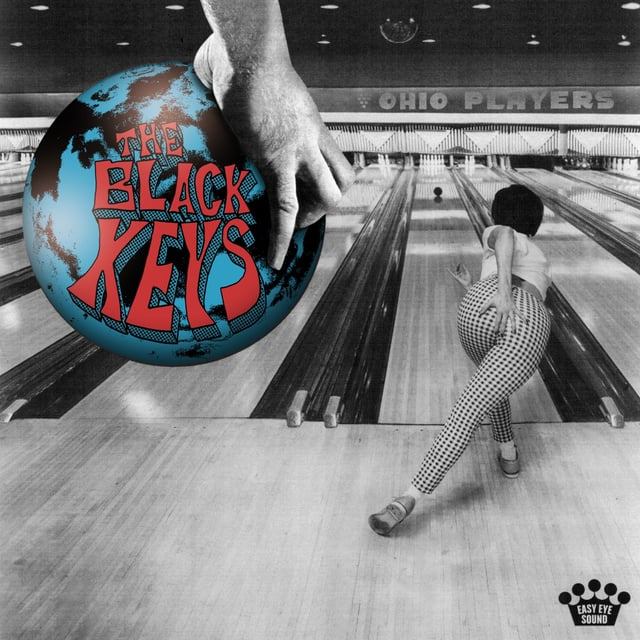
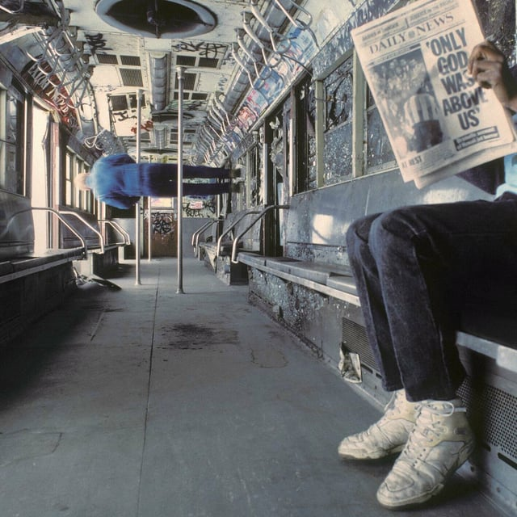
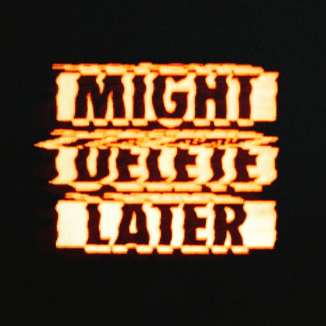

## <iframe style="border-radius:12px" src="https://open.spotify.com/embed/playlist/6gMSPSxEiSTn38cVSvu69t?utm_source=generator&theme=0" width="100%" height="352" frameBorder="0" allowfullscreen="" allow="autoplay; clipboard-write; encrypted-media; fullscreen; picture-in-picture" loading="lazy"></iframe>

---

## The Black Keys - Ohio Players

Oh my gosh, I have so many thoughts, but to summarize: I think Dan Auerbach is doing what he does best, collaborating and nerding out about music with others. This record is a blast.

---

## Vampire Weekend - Only God Was Above Us

Ezra Koenig (MARRIED TO RASHIDA JONES!!!! TAKE THAT JIM HALPERT!) grapples with being a dad, 40, and not fitting in his argyle Ivy League sweaters anymore. Love how wild this album is, and glad to see former band member Rostam came back for the track “The Surfer”.

---

## Khruangbin - A La Sala

I heard someone say that Khruangbin is what the inside of a lava lamp must sound like. Recorded in a barn with “ambient nature sounds piped into their headphones while recording,” this pared-down album is a perfect soundtrack for our upcoming sunny days.

---

## J. Cole - Might Delete Later

UH OH! Someone has beef with Kendrick Lamar!?!?! OH SNAP! J. Cole dropped a surprise album last night at midnight, apparently very upset that Kendrick roasted him and Drake on his current No. 1 chart-topper “Like That” with Metro Boomin. Beware when J. Cole claps back…
