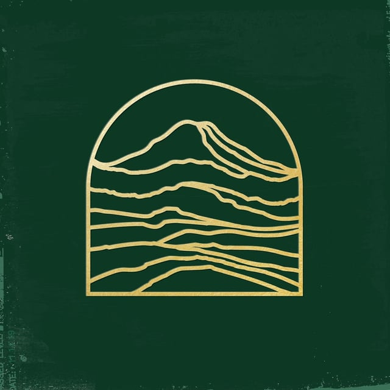

## [Soma Tacoma - Songs from the Valley](https://somatacoma.bandcamp.com/album/meanwhile-stories-songs-from-the-valley)

_Alex Wirth Edition ❤️_

Alex and some other friends/artists at our church have been working on this album for over 4 years now. It’s been an insane labor of love and it documents some “dark nights of the soul”. We lost our pastor to suicide in 2019, then about 2 months later the pandemic hit. These are the songs that came out of the grief, the glimpses of hope, and the healing of a community sorting through the wreckage while reconciling our beliefs with the human experience.

You can stream it or pay what you want on [Bandcamp](https://somatacoma.bandcamp.com/album/meanwhile-stories-songs-from-the-valley), and it’s on all the usual streaming services too.
