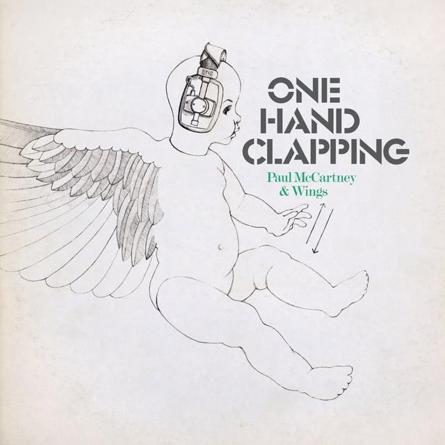

## <iframe style="border-radius:12px" src="https://open.spotify.com/embed/playlist/52pE0wpJaEFeYe3jt5ezIJ?utm_source=generator&theme=0" width="100%" height="352" frameBorder="0" allowfullscreen="" allow="autoplay; clipboard-write; encrypted-media; fullscreen; picture-in-picture" loading="lazy"></iframe>

---

## Hermanos Gutiérrez - Sonido Cósmico

_Tasting Notes: Breaking Bad, IN SPACE!_

The brothers are back and taking us on a sonic exploration of the astral planes. Where their 2022 masterpiece, El Bueno Y El Malo, placed us right in the middle of old Western cinema, their new album introduces some richer, deeper textures and instrumentation that turn our heads to the skies.

---

## Paul McCartney & Wings - One Hand Clapping

_Tasting Notes: A 1970s B-film training montage_

The final living member of the Beatles (I know, I know, Ringo), Paul McCartney cashes in an old bootleg album sitting in the vaults since 1974. He has to pay off the Spanish castle somehow. McCartney originally wrote off this Abbey Road TV special as nothing special but has since come around. I think we’re all the better for it—an 84-minute romp through some of the band’s most beloved songs. If you haven’t dug much into McCartney’s solo projects, this is a great introduction.

---

## Raveena - Where the Butterflies Go in the Rain

_Tasting Notes: A Volkswagen Beetle bumpin’ Spice Girls_

The R&B-pop hybrid genre is having a year. And I think Raveena might have just taken the crown with this early-2000s Norah Jones / Christina Aguilera / her-own-thang-esque LP, “Where the Butterflies Go in the Rain”. Raveena’s vocals are so beautiful and crisp. She has the gift of control, knowing when to lean in or fade away. The album’s 50-minute runtime doesn’t overstay its welcome and has some spectacular moments, like a JPEGMAFIA feature that I did not think could work as well as it does.

---

## And More!

- Luke Combs - Fathers & Sons
- Cola - The Gloss
- The Decemberists - As It Ever Was, So It Will Be Again
