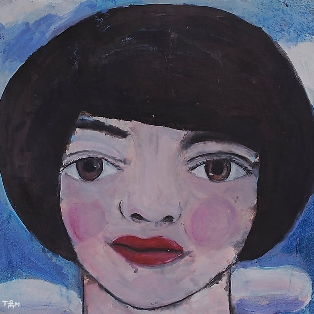

## <iframe style="border-radius:12px" src="https://open.spotify.com/embed/playlist/3gY3ifhFa22y4KchDZoQJ9?utm_source=generator&theme=0" width="100%" height="352" frameBorder="0" allowfullscreen="" allow="autoplay; clipboard-write; encrypted-media; fullscreen; picture-in-picture" loading="lazy"></iframe>

---

## Bonny Light Horseman - Keep Me on Your Mind/See You Free

_Tasting Notes: A beloved tour van with 250,000 miles on it, filled with friendship and banjos._

The folksy supergroup comprised of 8-time Tony Award playwright Anaïs Mitchell, Mr. Fruit Bats Eric D. Johnson, and extreme-hyphenate Josh Kaufman gift us with a tender hour of harmonies about raising children, growing old with your love, hope, sorrow, and ‘the blessed mess of our humanity’. They embody a security and confidence that can only come from a band that deeply enjoys playing together and that has seen a lot of road.

So glad we get another Bonny Light Horseman album! Each of these artists could be doing almost anything right now and probably cash much bigger checks doing it, which makes this album all the more special.

---

## Kaytranada - TIMELESS

_Tasting Notes: A J Dilla Donut with Gen Z icing and early-2000s-hip-hop sprinkles_

Grammy-winning artist Kaytranada is back, back again. He brought his usual suspects with rich features from Childish Gambino, Thundercat, Channel Tres, Anderson .Paak, Lou Phelps, and like a kajillion more. Like his contemporaries, Kay finds himself in this pocket of supremely danceable and yet slightly off-kilter classics.

---

## Tems - Born in the Wild

_Tasting Notes: A heart-to-heart with your mom at the kitchen table._

_Special thanks to a friend for sharing this one!_

Nigerian pop artist Tèmìládé drops a spiritual powerhouse of an album that pairs back-of-neck chills with afrobeat heaters! In this album, she seems locked in and secure in her blend of neo-soul, R&B, and all of her secret ingredients.

> _“So my dear, I can see now why you are stumbling a bit and having some mental doubts. Never lose your focus. Don’t be out there to please anybody. You’re only there to please God.”_
