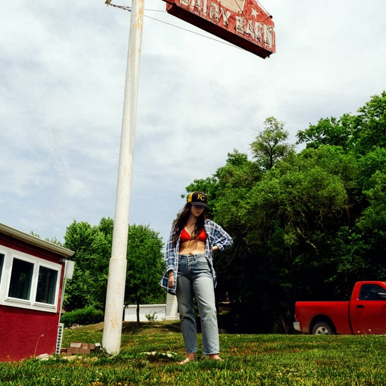
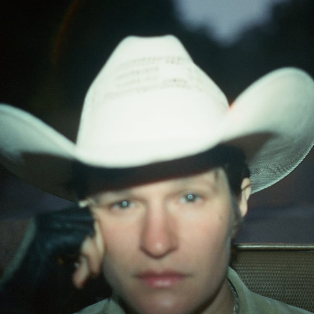
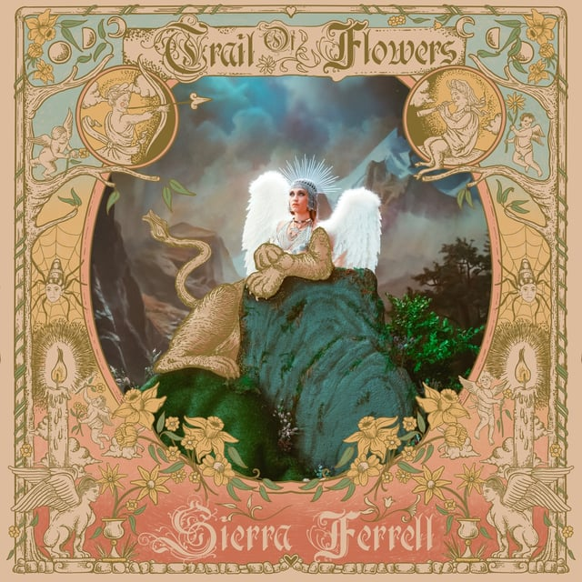

WHOOOWEEE is it a big week for music! It’s fun gathering up all the albums that came out today and thinking about if there’s any through-line, any theme that may shine throughout each of the albums. To me, there’s a definite touch of spring, or new life, to each of these offerings. A subtle tinge of hope after long seasons of dark and unrelenting cold.

## <iframe style="border-radius:12px" src="https://open.spotify.com/embed/playlist/4RviyZacBuqDDgrc3g8uiA?utm_source=generator&theme=0" width="100%" height="352" frameBorder="0" allowfullscreen="" allow="autoplay; clipboard-write; encrypted-media; fullscreen; picture-in-picture" loading="lazy"></iframe>

---

## Waxahatchee - Tigers Blood

Katie Crutchfield does it again! This heartland-rock/alt-country album is like a sweet golden-hour ride in the back of a pickup truck with your best friends. Wax has been an absolute force since her 2012 “breakup-album-made-in-a-cabin-in-a-week” album American Weekend. This time, her self-destructive tendencies make way for a healthier, confident, contented album. Seems like she found a place of rest and comfort, and I’m happy for her. I’m also happy for us, because we get this album.

---

## Adrianne Lenker - Bright Future

ANALOG! Big Thief’s singer/songwriter/guitarist/perpetually-broken-hearted Adrianne Lenker releases this new quiet and organic album about love, loss, and finding a path forward. She recorded this album with a close group of friends directly to analog tape, so no computer was used to make this album, which is neat. I especially like how beautiful the piano recordings sound on this album.

---

## Sierra Ferrell - Trail of Flowers

Keeping the acoustic instrument themes flowing, Sierra Ferrell (violin AND VOCALS, crazy combo) came out with a HOOT of an album. I believe she’s from West Virginia, and apparently this album is named after the fact that she’s constantly putting flowers in her hair and on her body, and her friends know she’s been around because there will be a trail of flowers wherever she goes. This album takes a lot of fun turns! Listen to “Rosemary” with the lyrics up.

---

## Tyla - TYLA

Ready to party? The 22-year-old South African comes out swinging with her debut album that mixes Afropop with Amapiano, a house dance music sub-genre popular in Africa that blends jazz, house, and four-on-the-floor drums. It’s the type of album you listen to in your Volkswagen Cabriolet with the top down.

---

## Others!

- Gary Clark Jr. - JPEG RAW
- The Jesus and Mary Chain - Glasgow Eyes
- Marisa Anderson - Music from ‘A Perfect Day For Caribou’
