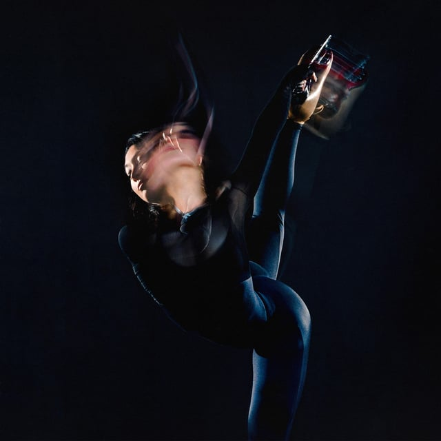

## <iframe style="border-radius:12px" src="https://open.spotify.com/embed/playlist/2riIaA6A1yQq9DqGcJAF8b?utm_source=generator&theme=0" width="100%" height="352" frameBorder="0" allowfullscreen="" allow="autoplay; clipboard-write; encrypted-media; fullscreen; picture-in-picture" loading="lazy"></iframe>

---

## Beyoncé - Cowboy Carter

GO OFF BEEHIVE! Beyoncé’s 27-track “Cowboy Carter” album has dropped. She kept a tight wrap on the album until its midnight release, but so far it’s a sweeping ode to the past, present, and future of country. And good news for the Miley and Dolly fans: both make proper appearances.

---

## Thee Sacred Souls - The Instrumentals

Perfect soul album for the sunshine coming this week. Like how it sounds? Try their 2022 self-titled LP. It’s like this album, but with words!

---

## Kelly Moran - Moves in the Field

A precise and emotive composer and piano player, Kelly Moran built a beautiful album of piano compositions using just a Yamaha Disklavier.

---

## Chastity Belt - Live Laugh Love

Walla Walla, Washington natives! This all-gal group’s new album feels like sitting in a living room, cheap beer in hand, while your sarcastic feminist friends have a band practice.
