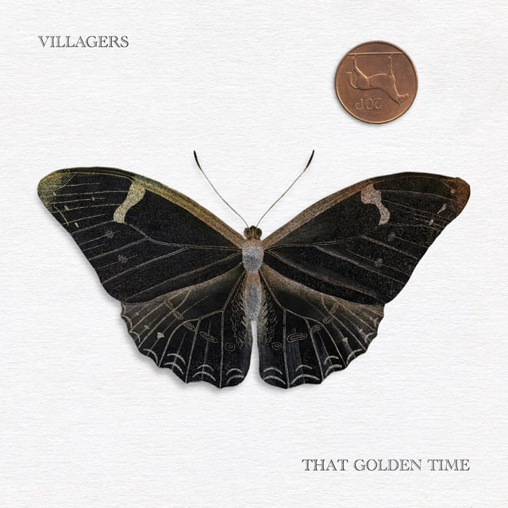
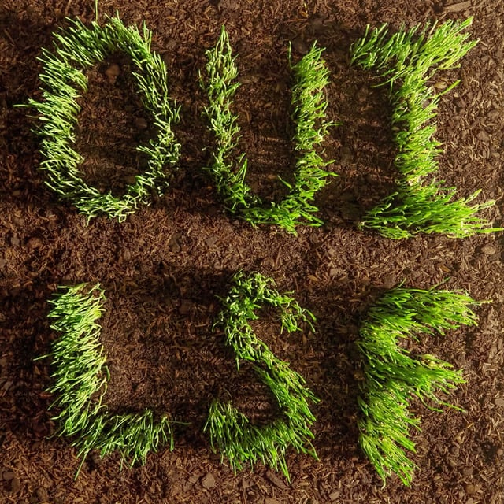
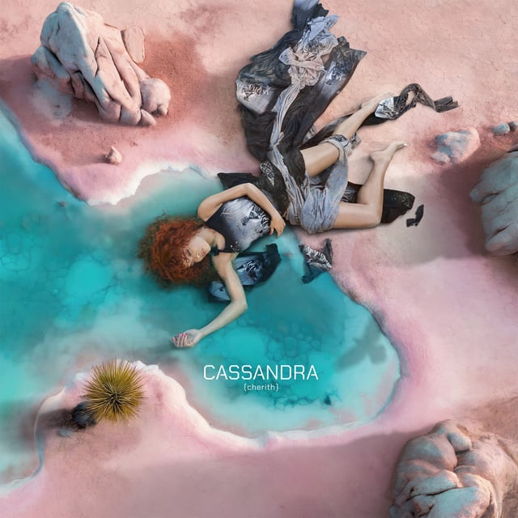
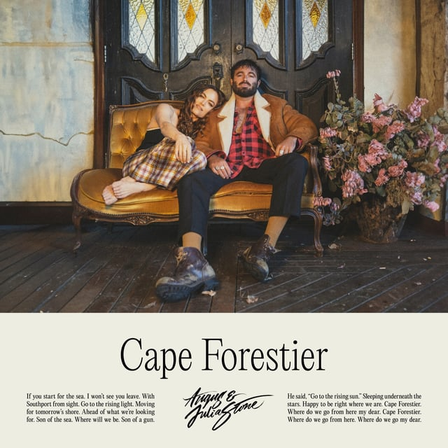

## <iframe style="border-radius:12px" src="https://open.spotify.com/embed/playlist/6c3T4brs5Zzrwxa3IYcMBQ?utm_source=generator&theme=0" width="100%" height="352" frameBorder="0" allowfullscreen="" allow="autoplay; clipboard-write; encrypted-media; fullscreen; picture-in-picture" loading="lazy"></iframe>

---

## Villagers - That Golden Time

_Tasting Notes: Sangria in the garden_

Dublin’s own Conor O’Brien pulls in the various experiments he concocted through the years and condenses them into a clean 44-minute suite of meaning-making. I can’t help but feel like I’m on a golden-hour drive with a friend, finally catching up on how they’ve made sense of their life over the past few years.

---

## Les Savy Fav - OUI, LSF

_Tasting Notes: Band Camp for Dads_

After not hearing from these five weirdos since 2010, Les Savy Fav kicks the post-hardcore door down and shoots straight for our ears. This album sips like a craft beer flight sampler, going from a rap-rock opus “Guzzle Blood” to hyper-listenable “Legendary Tippers” then landing on a punk-adjacent “World Got Great”. Art rock at its full-throated finest.

---

## Andra Day - CASSANDRA (cherith)

_Tasting Notes: Hollywood finally cast Idris Elba as Bond_

Edmonds, Washington, SOUND OFF! Powerhouse singer-songwriter Andra Day comes back with a wonderful blend of both timeless R&B/Soul and hip-hop sensibilities. Her voice is a gift, and her effortless little asides throughout the album make me smile.

---

## Angus & Julia Stone - Cape Forestier

_Tasting Notes: Bluey makes a Ben Howard album_

The magic in Cape Forestier is in hearing the harmony that can only come from a brother-sister duo who share in the intertwined weight of loss and discovery. Heading back to the warm acoustic tones of their earlier work, the album feels relatively safe, but maybe that’s what we need heading into a hot heavy summer.

---

## Others!

- Kings of Leon - Can We Please Have Fun
- Jim White & Marisa Anderson - Swallowtail
- A. G. Cook - Britpop
