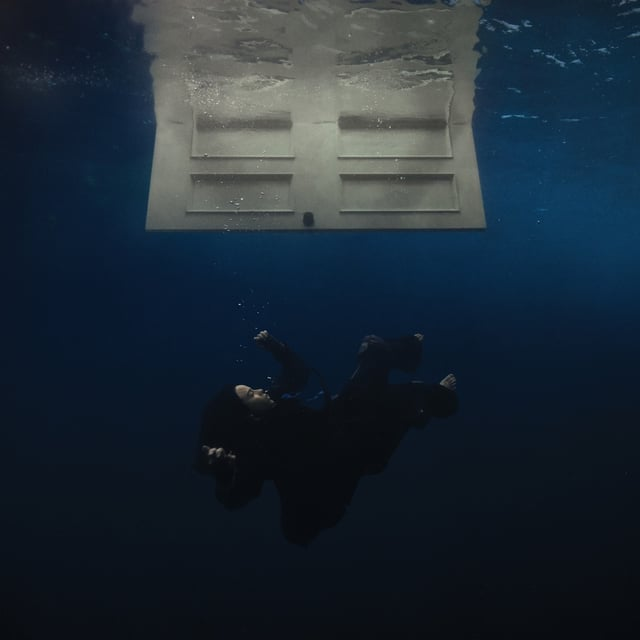
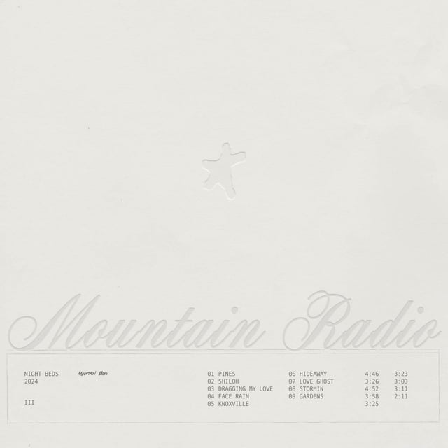
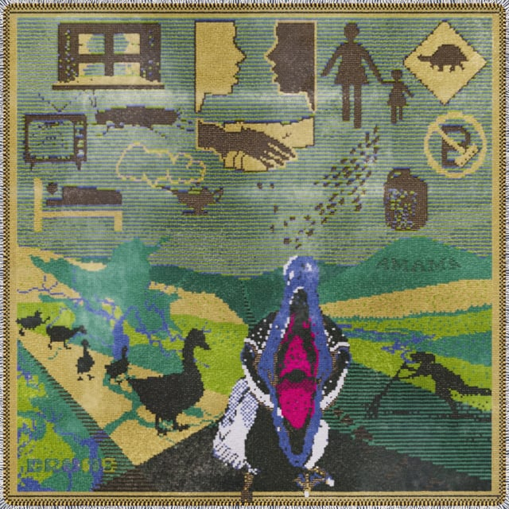

## <iframe style="border-radius:12px" src="https://open.spotify.com/embed/playlist/43WZ5BngFDqBDtUN5lRSOg?utm_source=generator&theme=0" width="100%" height="352" frameBorder="0" allowfullscreen="" allow="autoplay; clipboard-write; encrypted-media; fullscreen; picture-in-picture" loading="lazy"></iframe>

---

## Billie Eilish - HIT ME HARD AND SOFT

_Tasting Notes: New packaging but the same great taste!_

Billie’s back baybeeeeeee. Dropping a new album with no pre-released singles, this album hit the world’s ears late last night. It’ll take some repeat listens, but so far I’ve enjoyed her and Finneas leaning into dance/club sounds and felt like BLUE was a terrific way to land the album. Not quite a concept album, I’m still trying to decide if it feels like a cohesive whole. But for now, I know I’ll have CHIHIRO, THE GREATEST, and BITTERSUITE on repeat for the foreseeable future.

---

## Night Beds - Mountain Radio

_Tasting Notes: An ethereal space where a man wearing a cowboy hat makes a Bon Iver album._

In past Night Beds albums, you couldn’t help but ask “Who hurt you, Winston Yellen?” On Mountain Radio, I’m asking “Where’d you get your hope from, Winston Yellen?” Always a gifted ear-worm hunter, Night Beds infects the mind with beautiful melodies that could give pre-Cindy-Lou-Who Grinch the bathtub cries. So glad they came back to bring us this album after almost ten years. (If you haven’t listened to their 2013 masterpiece Country Sleep, go on, get it.)

> _God as my witness, I’m not indifferent_ 
> _Loving is wherever you are_ 
> _God as my witness, with your permission_ 
> _I’d love you with all of my heart_

---

## Rapsody - Please Don’t Cry

_Tasting Notes: Being in a group therapy session with someone much further along than you._

North Carolina rapper Rapsody returns from a 4-year hiatus with an album simultaneously raw and polished to perfection. The 22 tell-all/testimonial songs stay fresh throughout the 1-hour and 5-minute runtime. Rapsody is on another level lyrically and harkens back to different eras, slotting into each of them easily.

---

## Crumb - AMAMA

_Tasting Notes: Your cool older cousin bought a Moog._

New York psych-pop darlings are keeping their healthy diet of strange and sophisticated on their new album AMAMA. A free-wheeling, open-hearted album filled to the rafters with synths, pads, and fuzzed-to-oblivion guitars. It’s a treat for your washed-out ears.

---

## Cage the Elephant - Neon Pill

_Tasting Notes: 2000–2005_

I can’t talk about it.

---

## Others!

- The Avett Brothers - The Avett Brothers
- Childish Gambino - Atavista (kinda new, a re-jiggering of his 2020 album, 3.15.20)
- Beth Gibbons - Lives Outgrown
- Joywave - Permanent Pleasure
