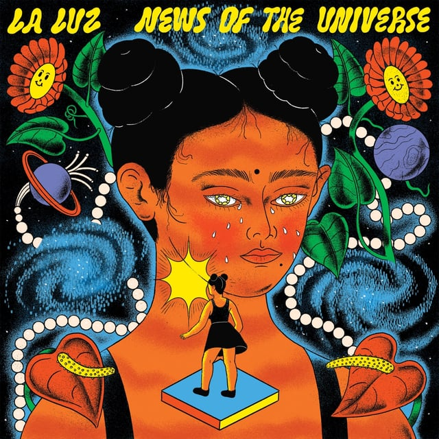
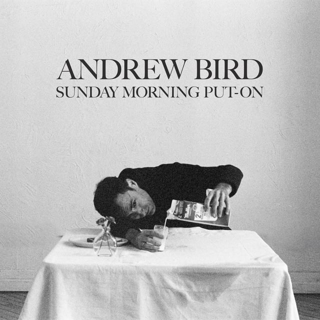
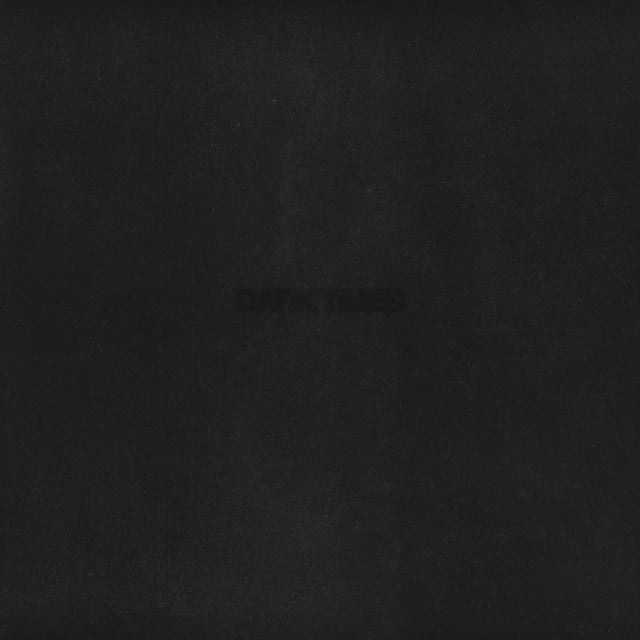
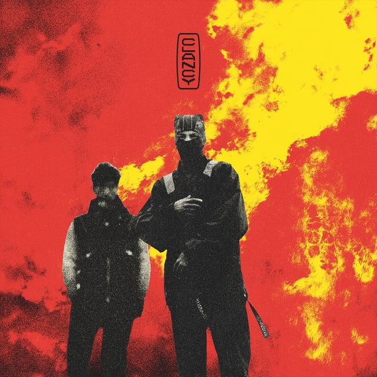

It’s a shorter one today. This week seemed to settle down after what’s felt like a 3-month-long onslaught of major releases. At least for the genres I follow.

## <iframe style="border-radius:12px" src="https://open.spotify.com/embed/playlist/23Cc0fNwMfBXbnA4obtrZ1?utm_source=generator&theme=0" width="100%" height="352" frameBorder="0" allowfullscreen="" allow="autoplay; clipboard-write; encrypted-media; fullscreen; picture-in-picture" loading="lazy"></iframe>

---

## La Luz - News of the Universe

_Tasting Notes: A pink Cadillac riding into space on some tasty bass lines._

Four-piece ladies-only supergroup La Luz blast off into outer space with this psychedelic rock opus. Grappling with a breast cancer diagnosis and the early days of motherhood, guitarist and songwriter Shana Cleveland explores the boundaries of life and the fight to push ever onward toward love amid a collapsing world.

---

## Andrew Bird - Sunday Morning Put-On

_Tasting Notes: Sucking on a Werther’s Original while sitting in front of Meema’s radio._

I can’t tell if Andrew Bird is prolific or if he just feels prolific. I think both. On “Sunday Morning Put-On” he takes us back to the old timey-wimey years of yore. Comprised of 1930s–40s jazz covers, Bird swaps out the brass for his favored violin and whistlin’ combo. Performed completely live in studio as a trio, it’s a fun jaunt back to the Great American Songbook.

---

## Vince Staples - Dark Times

_Tasting Notes: A hip-hop bedtime meditation app_

Abbott Elementary cameo star and boy wonder Vince Staples takes things down a notch on “Dark Times”. Keeping it simple and splashy, Vince raps about his upbringing and the past few years of his life over somber beats and some fresh live instrumentation.

---

## Twenty One Pilots - Clancy

_Tasting Notes: Teenage you riding your bike around a cul-de-sac with friends._

The rock-rap-pop duo’s back and seemingly more introspective than ever:

> It’s a different blue, it’s deeper than it’s been 
> I’ll be pulling into the parking lot before the heat kicks in

I’m just here for the drum recordings.
