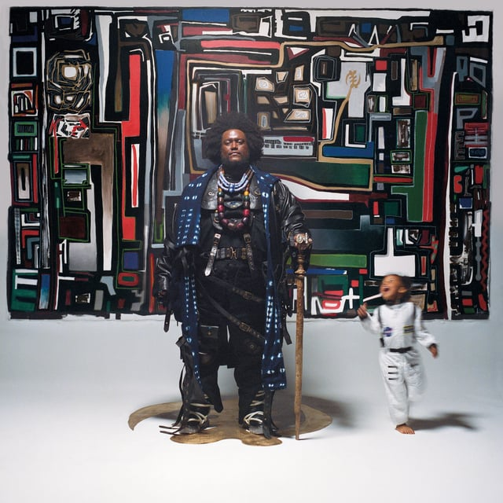
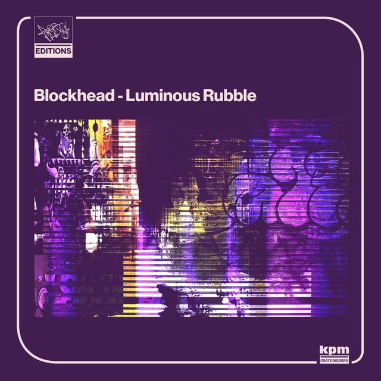
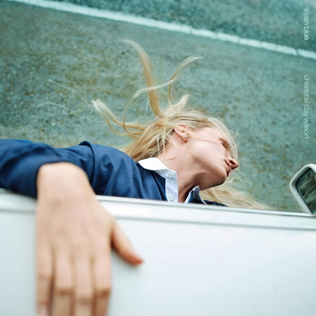
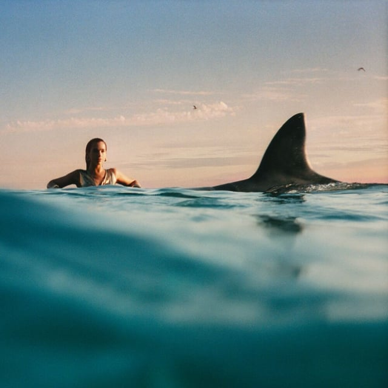

## <iframe style="border-radius:12px" src="https://open.spotify.com/embed/playlist/78FXWTfcn02DYiSV7003PW?utm_source=generator&theme=0" width="100%" height="352" frameBorder="0" allowfullscreen="" allow="autoplay; clipboard-write; encrypted-media; fullscreen; picture-in-picture" loading="lazy"></iframe>

---

## Kamasi Washington - Fearless Movement

The never-brief tenor-sax/multi-instrumentalist drops another hour-plus heater of an album. This LP leans heavily into the joy and a playfulness that can only come from being the father of a 3-year-old daughter, Asha. Thundercat continues to fill the album with basslines you could eat off, and it’s a ton of fun to hear some rap guest appearances too, coming full circle from Kamasi’s start working on Kendrick Lamar’s To Pimp a Butterfly.

---

## Hana Vu - Romanticism

A new (to me) artist that I haven’t been able to take off of my heavy rotation lately. Romanticism is a guitar-popsynth-driven coming-of-age album for this 24-year-old from LA. It’s always a treat to hear someone make an album that feels so unabashedly them without trying to fit into an industry mold or genre. I have a feeling this will make my top albums of 2024.

---

## Blockhead - Luminous Rubble

Beatmaker extraordinaire hits us with another LP of [funky-fresh](https://getyarn.io/yarn-clip/ab83229f-45b0-44ef-8a16-5e864862cb78) instrumentals to embarrassingly-try-to-freestyle-in-your-car to. With song titles like “SERIOUS ABOUT MY FITNESS” and “OH YOU FANCY” you can tell this is an artist who’s enjoying the ride.

---

## Charlotte Day Wilson - Cyan Blue

“I want to look through the unjaded eyes of my younger self again,” says the artist herself. It shows, even in the opening seconds of Cyan Blue’s opening track “My Way”. But the thing I’m enjoying most about this album is the balance between these “unjaded eyes of youth” and the range of her voice that only comes through maturity and experience.

---

## Dua Lipa - Radical Optimism

The pandemic’s favorite pop star, Dua Lipa, is back at the time-machine pop that sky-rocketed her into the hearts and minds of pop culture. Taking an “if it ain’t broke” approach to this album, there’s still a lot to like. Her fatal flaw was using permanent-grifter Kevin Parker (of Tame Impala fame) as a collaborator.
