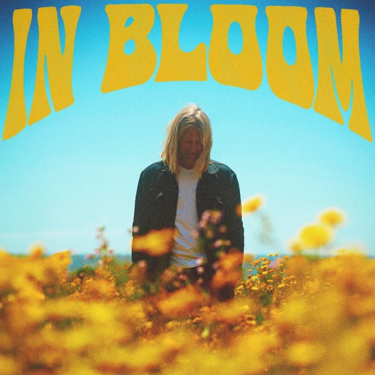

## <iframe style="border-radius:12px" src="https://open.spotify.com/embed/playlist/6yyI5uI2fOdDfLGO0D5bWQ?utm_source=generator&theme=0" width="100%" height="352" frameBorder="0" allowfullscreen="" allow="autoplay; clipboard-write; encrypted-media; fullscreen; picture-in-picture" loading="lazy"></iframe>

---

## Jon Foreman - In Bloom

_Tasting Notes: “I like long walks on the beach and cheap wine” — J.F._

Switchfoot’s eternal songbird, Jon Foreman, brings a new frolicking album and all summer with him. He continues his stripped-down optimistic musings on people, relationships, and existence, this time with even more support musically. I envy his ability to take life’s huge questions and route them into sticky hooks you’ll be humming for days.

> _Yesterday’s tomb, tomorrow’s womb_ 
> _The dark is long but the dawn is soon_ 
> _The light that you seek is seeking you_ 
> _Let the dead seed go and watch it grow brand new_ 
> _I’m a desert in bloom_

---

## ODESZA - The Last Goodbye Tour Live

_Tasting Notes: [2022 sweaty Brandon losing his mind](https://photos.app.goo.gl/C8zkBwDtQGK2nGsB8)_

Their comeback tour was one for the books. ODESZA, two Bellingham, WA natives Harrison Mills and Clayton Knight, hit the sweet spot timing-wise: right as the COVID restrictions lifted, they sold out Climate Pledge Arena two days straight. We were fortunate enough to be there on the first night and it did not disappoint. Getting to listen to the setlist again brings it all back.

---

## Arooj Aftab - Night Reign

_Tasting Notes: NOW! That’s What I Call Jazz 2024_

Pakistani-American singer Arooj Aftab has swum in a few different sonic circles through the past decade. Still, after her 2021 critical darling, Vulture Prince, the anticipation for a follow-up in kind could not have been stronger. She stuck the dismount. This album walks us through all the various experiences of love: the passion, sadness, and grief of it all. At some points the album haunts you, at others it comforts you; it’s a gift for the ears.
