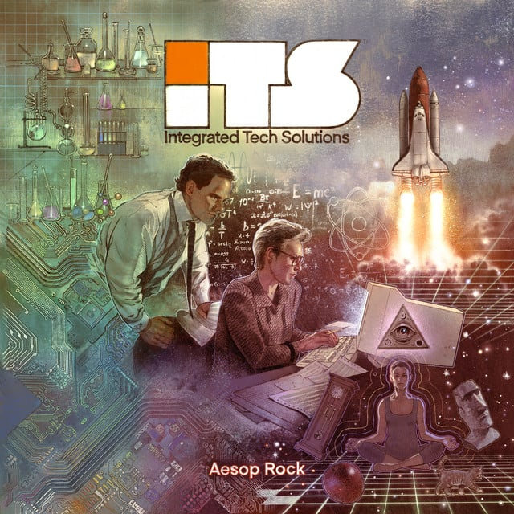

IT’S NEW MUSIC FRIDAY BUT GUESS WHAT!? IT DOESN’T MATTER!!!! AESOP ROCK JUST DROPPED HIS NEW ALBUM!!!!

## <iframe style="border-radius:12px" src="https://open.spotify.com/embed/album/64L1urQKsuPJQMteCZX6pX?utm_source=generator&theme=0" width="100%" height="352" frameBorder="0" allowfullscreen="" allow="autoplay; clipboard-write; encrypted-media; fullscreen; picture-in-picture" loading="lazy"></iframe>

---

## Aesop Rock - Integrated Tech Solutions

_Tasting Notes: Glory, the greatest rapper alive, an underground king_

Ian’s been droppin’ STRAIGHT BOMBS for over 20 years. His 9th studio album isn’t much of an evolution for him, but his flow is still golden butter and it’s cool to see him try his hand at a high-concept album. His self-produced beats are still quirky, hilarious at times, and amazing. His lyrics and wordplay are still my favorite in all of hip hop. Billy Woods also drops some BARS on “Living Curfew”. Am I gushing? I love Aesop.
