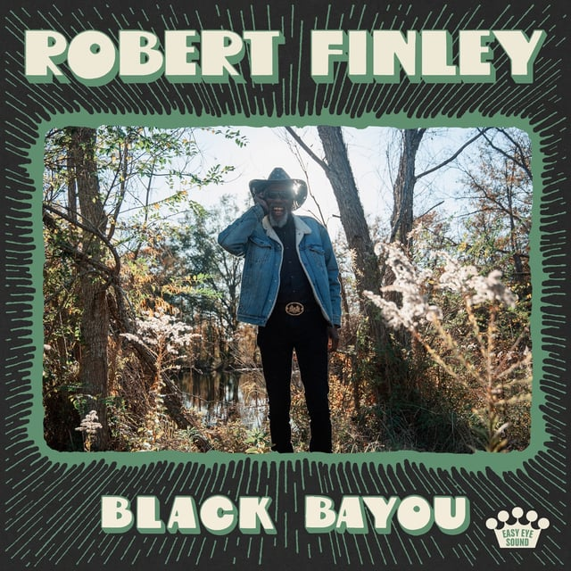
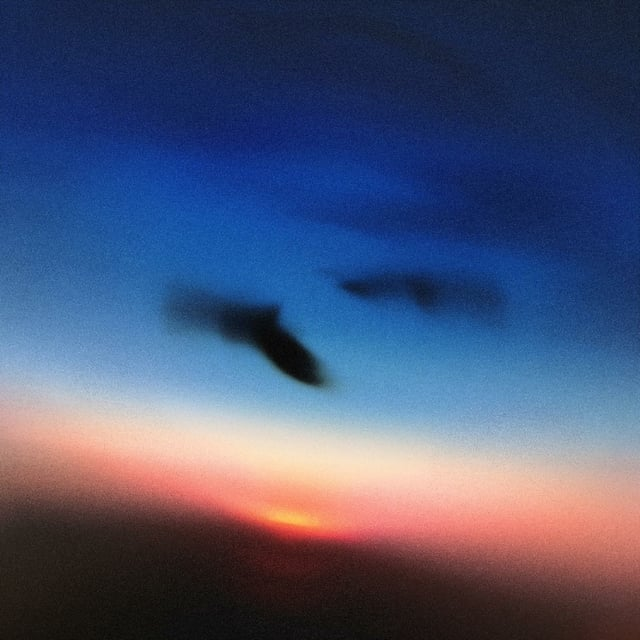
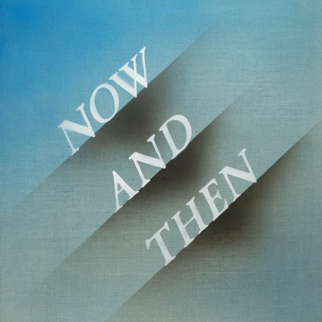
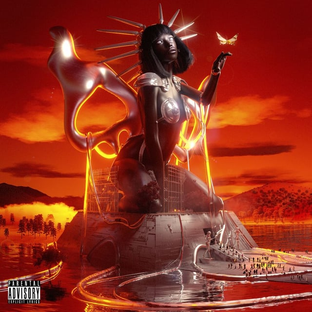

## <iframe style="border-radius:12px" src="https://open.spotify.com/embed/playlist/61SQvvynyE3kJE4YSONBA8?utm_source=generator&theme=0" width="100%" height="352" frameBorder="0" allowfullscreen="" allow="autoplay; clipboard-write; encrypted-media; fullscreen; picture-in-picture" loading="lazy"></iframe>

---

## Robert Finley - Black Bayou

_Tasting Notes: Blues Rock, Remember the Titans soundtrack, The Black Keys_

Man, I’m mad I missed this last week! Robert Finley, a blind blues singer from Louisiana, has been teaming up with Dan Auerbach from The Black Keys since 2016 and making some absolutely soulful bangers! His rich smoky voice pairs perfectly with Dan Auerbach’s blues rock instrumentation. Also, adorably, his daughter and granddaughter do all the backup vocals on the album.

---

## Resavoir - Resavoir

_Tasting Notes: BadBadNotGood, a sleepier Snarky Puppy, Math jazz!_

Chicago trumpeter and band leader Will Miller leads an incredible 18-piece ensemble through a hip-hop indie-rock dreamscape of an album all about interconnectedness. You can definitely feel that theme throughout the album and how this band just sits in the pocket perfectly like they’re some siamese-18-tuplets. Great background music to inspire you!

---

## The Beatles - Now and Then

_Tasting Notes: The Beatles, ¯\\\_(ツ)\_/¯_

Insane that we’re getting what’s being called “The Final Beatles Song” today. Now and Then brings together a recording of John Lennon from 1977, George Harrison’s guitar work from the 1995 session, and new contributions from Paul McCartney and Ringo Starr. What a time to be alive.

---

## Hotline TNT - Cartwheel

_Tasting Notes: Wonderwall, PLAY IT LOUD ROCK N’ ROLL, Shoegaze_

I’ve never understood what “Shoegaze” was as a genre, but I think this album helps me understand it. It’s a great blend of heartbreak-based rock and roll that deserves to be played at full volume and an ethereal lifting of the spirit. Want to get into your feelings and go full send? Here you go.

---

## Tkay Maidza - Sweet Justice (Explicit)

_Tasting Notes: Beastmode Hip Hop, clubbin’, Kendrick Lamar’s HUMBLE._

I’m gonna let her speak for herself:

> I’m 5150, I run through yo city, I’m strapped with machetes 
> Believe me, I’m petty, I’m rocky, I’m ready

**_I just woke up and chose violence._**
