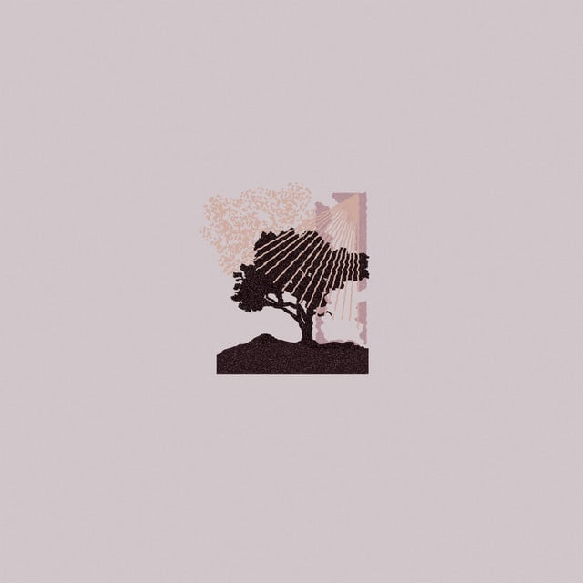
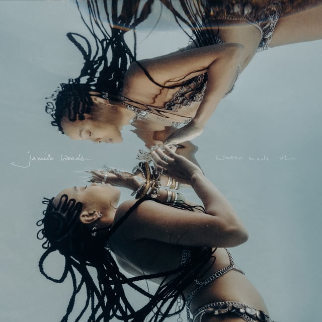

## [Land of Talk - Performances](https://open.spotify.com/album/5bAbAs3LZaIc3IXwhNnaPm)

Their 2008 “Some Are Lakes” is a favorite of mine from this garage-rock “actually-lofi” band. Lizzie Powell, the front-woman, is a quiet powerhouse. This album is awesome so far. Tell me if you get why they named their instrumental song “Pwintiques” and I’ll owe you a firm handshake.

---

## [Aesop Rock’s new single!](https://open.spotify.com/track/1Df6eUumU7gcARwQnXtDEy) (explicit)

Aes is about to drop a monster album on Nov 10th that’s a high-concept outing about: “an organization offering ‘lifestyle- and industry-specific applications designed to curate a desired multi-experience,’ _Integrated Tech Solutions_ picks apart the charlatan language that hears app inventors put themselves on continuums starting with cavemen and continuing through da Vinci.”

---

## [Jamila Woods - Water Made Us](https://open.spotify.com/track/4IkvZVpMPKr8Ym7MVok7El)

Chicago singer/poet comes out with a hot one! I want to know why she’s dropping this album in the fall because it’s a real fun “summer” album to me. If track 3 “Practice” doesn’t get you swaying, go see a doctor.

---

## Hot Leads!

- [L’Rain - I Killed Your Dog](https://open.spotify.com/album/2O01P3dwp47dyImCnTdfyo): Indie rock gone off the rails. Taja Cheek is hilarious.
- [Rick Astley - Are We There Yet?](https://open.spotify.com/album/0BuCV5EL2sM6iUvaxFtpPx): Is he ever gonna give it up?
- [Laura Misch - Sample the Sky](https://open.spotify.com/album/5GDOeUL17GyrbfIe8J9Hyc): Saxophone EDM?
