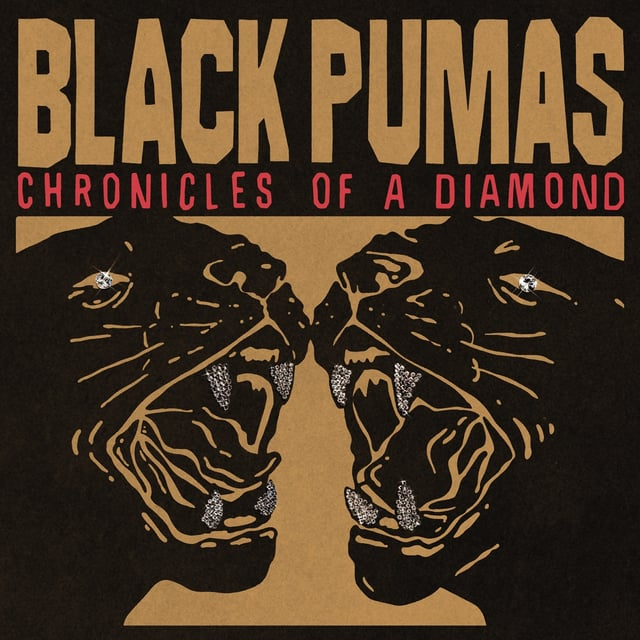
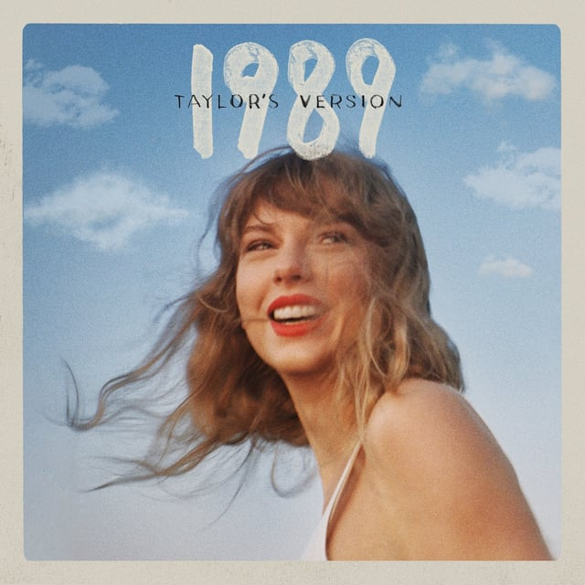
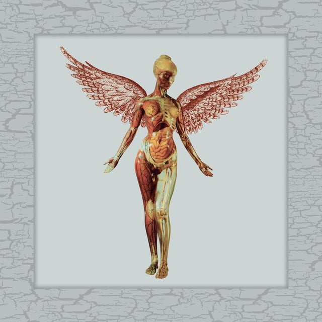

## <iframe style="border-radius:12px" src="https://open.spotify.com/embed/playlist/4tNyG96PRSbcs6Vrhu3rgS?utm_source=generator&theme=0" width="100%" height="352" frameBorder="0" allowfullscreen="" allow="autoplay; clipboard-write; encrypted-media; fullscreen; picture-in-picture" loading="lazy"></iframe>

---

## Black Pumas - Chronicles of a Diamond

_Tasting Notes: Leon Bridges, The Black Keys, Alabama Shakes, The Doors_

Rock N Roll ain’t dead, it’s just been malnourished and underfed. Until today. Black Pumas brings in some killer old-school “Rock N Soul” vibes that I think you’ll really like. Eric Burton’s voice is angelic.

---

## Taylor Swift - 1989 (Taylor’s Version)

_Tasting Notes: An insufferable high school best friend who’s always complaining about their hopeless love life_

It’s here. Probably the most anticipated of the “Taylor’s Version” saga. Fun to hear lightly reimagined versions of Blank Space, Out of the Woods, Shake It Off, and all the rest.

---

## Sofia Kourtesis - Madres

_Tasting Notes: Odesza, Sylvan Esso, Jungle_

A beautiful album that Sofia wrote and dedicated to her mother, who was given a terminal cancer diagnosis. Sofia pleaded with a renowned surgeon to do an experimental operation on her mother, and if he saved her life, she promised to name a song after him. Her mother is now a cancer survivor, and the surgeon is track #3: Vajkoczy.

---

## Nirvana - In Utero (30th Anniversary Super Deluxe)

_Tasting Notes: Teen Spirit, the foyer of grunge and garage rock as we now know it_

A trove of previously unreleased live performances by the Kings of Aberdeen, Washington. If you haven’t listened all the way through In Utero, this is a great way to experience what made Kurt Cobain and Nirvana so magnetic and resonate with a generation of angry teenagers.

---

## King Gizzard & The Lizard Wizard - The Silver Cord

_Tasting Notes: If a psychedelic mushroom built a synthesizer._

Of course it’s 2 hours long.
